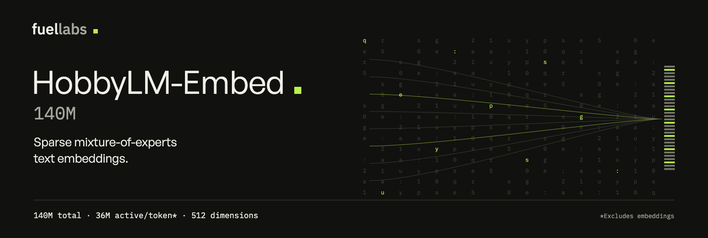
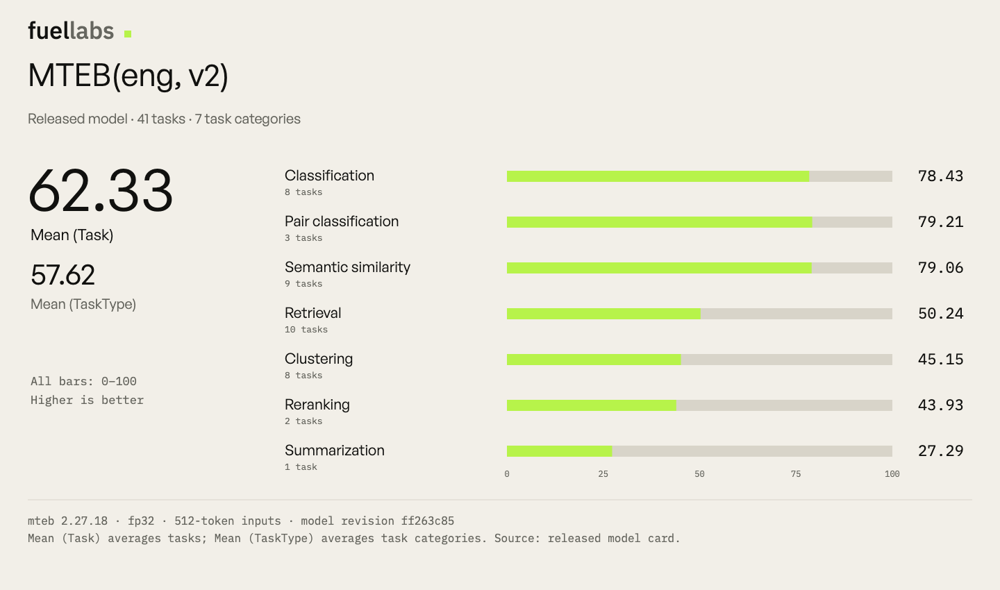
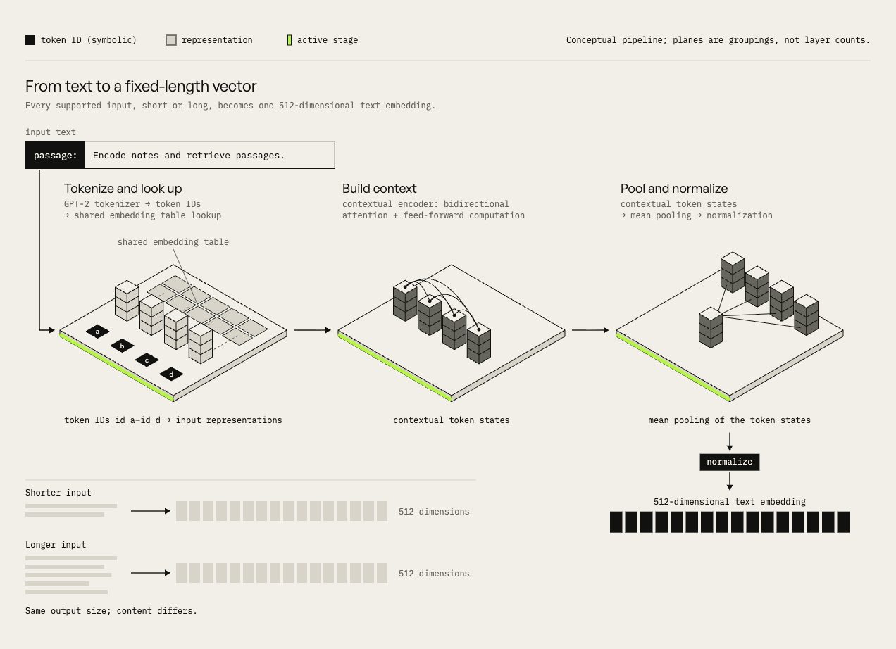
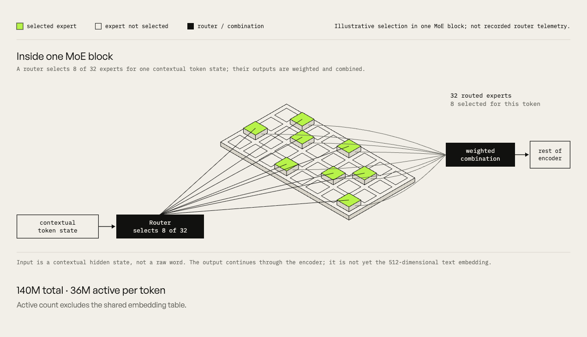

<picture>
  <source media="(max-width: 640px)" srcset="https://raw.githubusercontent.com/fuellabs-ai/hobbylm-embed-140m/main/assets/embed-banner-mobile.png">
  
</picture>

# HobbyLM-Embed-140M

An English text-embedding model built on a sparse mixture-of-experts encoder, trained from scratch: **140M total parameters, 36M active per token** (excluding embeddings, the MTEB convention). It produces dense 512-dimensional embeddings for search, retrieval-augmented generation (RAG), similarity, clustering and classification.

This repository holds the inference code: the model code, examples, the GGUF converter and llama.cpp helper, and offline tests. Training code and data are not included.

| | |
|---|---|
| Model weights | [harims95/hobbylm-embed-140m](https://huggingface.co/harims95/hobbylm-embed-140m) |
| Code and examples (this repo) | [github.com/fuellabs-ai/hobbylm-embed-140m](https://github.com/fuellabs-ai/hobbylm-embed-140m) |
| GGUF (llama.cpp) | [harims95/hobbylm-embed-140m-gguf](https://huggingface.co/harims95/hobbylm-embed-140m-gguf) |
| MLX (Apple Silicon, float16) | [harims95/hobbylm-embed-140m-mlx](https://huggingface.co/harims95/hobbylm-embed-140m-mlx) |
| Demo (Hugging Face Space) | [harims95/hobbylm-embed-140m-demo](https://huggingface.co/spaces/harims95/hobbylm-embed-140m-demo) |
| Cookbooks | [fuellabs-ai/cookbooks](https://github.com/fuellabs-ai/cookbooks) |
| MTEB | [leaderboard](https://huggingface.co/spaces/mteb/leaderboard) · [model entry](https://github.com/embeddings-benchmark/mteb/pull/5967) · [submitted results](https://github.com/embeddings-benchmark/results/pull/858) |
<!-- 7 pm: add | Paper | [Zenodo DOI](https://doi.org/<real DOI>) | here -->
| Licence | Apache-2.0 (gguf/ scripts: MIT, see [NOTICE](NOTICE)) |

## Repository layout

```
hobbylm_hf/        model code, byte-identical to the files shipped with the weights (SHA256SUMS.txt)
examples/          quickstart (encode_query / encode_document), semantic search, plain-text similarity
gguf/              GGUF converter, llama.cpp helper (exact pooling) and RUN-LOCALLY.md
mlx/               MLX port for Apple Silicon, with its check against Sentence Transformers
tests/             offline tests: code hashes, pooling contract, example outputs vs stored reference vectors
requirements.txt   tested versions (CPU)
LICENSE, NOTICE
```

## Quickstart

```bash
pip install -U sentence-transformers
```

```python
from sentence_transformers import SentenceTransformer

model = SentenceTransformer("harims95/hobbylm-embed-140m", revision="ea708cee107818fa0c1871eebd26d82a1e3fb1aa",
                            trust_remote_code=True)

queries = ["how do vaccines work?"]
passages = [
    "Vaccines train the immune system to recognise a pathogen without causing the disease.",
    "The Eiffel Tower was completed in 1889.",
]

q = model.encode_query(queries)        # adds "query: "
p = model.encode_document(passages)    # adds "passage: "
print(q.shape)                         # (1, 512)
print(model.similarity(q, p))          # higher = more relevant
```

**Prompts.** For search and RAG, queries need `query: ` and documents need `passage: `. `encode_query` / `encode_document` (or `prompt_name="query"` / `prompt_name="passage"`) add them for you; typing them yourself gives the same vector, but never do both. For similarity, clustering and classification, use plain text with no prefix.

**Notes**
- `trust_remote_code=True` is required: the MoE encoder is custom code shipped with the weights (the same files as [`hobbylm_hf/`](hobbylm_hf/)).
- Embeddings are already L2-normalised, so cosine similarity equals the dot product.
- Input length: 512 tokens by default, which is what MTEB(eng, v2) was measured at. For long documents, see 'Long documents' below.
- If the first download fails, retry.

## Examples

```bash
pip install -r requirements.txt
python examples/quickstart.py
python examples/semantic_search.py "how do plants make food"
python examples/similarity.py
```

Output (CPU):

```
embedding shape: (2, 512)
'what is the capital of france' -> 'Paris is the capital and largest city of France.' (cosine 0.7302)
'how do vaccines work' -> 'Vaccines train the immune system to recognise a pathogen without causing the disease.' (cosine 0.6527)

query: how do plants make food
1. 0.7139  Photosynthesis lets plants turn sunlight, water and carbon dioxide into glucose and oxygen.
2. 0.4826  A balanced diet includes fruit, vegetables, whole grains and protein.
3. 0.3553  Regular exercise improves heart health and mood.

0.8298  'A man is playing a guitar.' vs 'Someone is playing an instrument.'
0.4920  'A man is playing a guitar.' vs 'The stock market fell sharply today.'
0.5585  'Someone is playing an instrument.' vs 'The stock market fell sharply today.'
```

The examples pin the model to a fixed revision ([`examples/_load.py`](examples/_load.py)) and run in float32.

## Measured results

<picture>
  <source media="(max-width: 640px)" srcset="https://raw.githubusercontent.com/fuellabs-ai/hobbylm-embed-140m/main/assets/embed-benchmarks-mobile.png">
  
</picture>


**MTEB(eng, v2), all 41 tasks:** **62.33** Mean (Task), **57.62** Mean (TaskType).
Scored with `mteb` 2.27.18, fp32, max length 512, through the official MTEB loader at model revision `ff263c85`.
Officially on MTEB: both the model entry and the results are merged into MTEB ([submitted results](https://github.com/embeddings-benchmark/results/pull/858)).

| Task type (tasks) | Score |
|---|---:|
| Classification (8) | 78.43 |
| Pair classification (3) | 79.21 |
| STS (9) | 79.06 |
| Retrieval (10) | 50.24 |
| Clustering (8) | 45.15 |
| Reranking (2) | 43.93 |
| Summarization (1) | 27.29 |

**Training data and zero-shot.** Fine-tuning used the **training splits** of some MTEB tasks (never their test splits), and some training text comes from the same source corpora as some MTEB tasks. We declare all of them in the model's MTEB entry: 26 of 41 tasks, so MTEB lists the model as **36% zero-shot**. The final checkpoint was selected using MTEB scores. Treat the benchmark mean as optimistic for domains the model has not seen, and evaluate on your own data.

### How it compares

Among the 51 models on the MTEB(eng, v2) leaderboard with under 40M active parameters and results on all 41 tasks, HobbyLM-Embed-140M has the 8th-highest average score (Mean (Task)): 62.33.

| # | Model | Mean (Task) | Leaderboard rank | Total params | Active params |
|---:|---|---:|---:|---:|---:|
| 1 | avsolatorio/GIST-small-Embedding-v0 | 64.76 | 72 | 33.4M | 21.6M |
| 2 | codefuse-ai/F2LLM-v2-80M | 64.55 | 97 | 80.1M | 31.6M |
| 3 | BAAI/bge-small-en-v1.5 | 64.30 | 89 | 33.4M | 21.7M |
| 4 | abhinand/MedEmbed-small-v0.1 | 63.98 | 92 | 33.4M | 21.6M |
| 5 | MongoDB/mdbr-leaf-mt | 63.97 | 85 | 22.7M | 11.0M |
| 6 | RiverRider/motherlode-code-small-en-v0.1 | 63.46 | 99 | 33.4M | 21.6M |
| 7 | thenlper/gte-small | 63.22 | 96 | 33.4M | 21.6M |
| 8 | **harims95/hobbylm-embed-140m** | **62.33** | 132 | 140.0M | 36.4M |
| 9 | hotchpotch/bekko-embedding-v1-a25m | 62.25 | 117 | 123.2M | 24.9M |
| 10 | ManiacLabs/miniac-embed | 62.08 | 102 | 33.4M | 21.4M |

Method: live MTEB(eng, v2) leaderboard, 24 November 2026; active parameters as MTEB counts them (the registered `n_active_parameters_override` if set, else total minus embedding parameters); ordered by Mean (Task) over the 41 tasks, with the leaderboard's official (Borda) rank shown alongside. HobbyLM-Embed has 140M total parameters and is listed at 36% zero-shot. Full list: [CSV](assets/under40m-active-mteb-eng-v2-2026-11-24.csv).

## Long documents (up to 2,048 tokens)

The model reads up to 2,048 tokens. For long-document search (contracts, transcripts, reports), turn it on with one line:

```python
model.max_seq_length = 2048
```

On LongEmbed's four real long-document retrieval tasks this raises search quality from 36.1 to 49.3 (nDCG@10, +13.3). The default stays 512 because it matches our MTEB evaluation, and similarity between long texts (for example long news articles) is slightly better at 512.

LongEmbed retrieval (mteb 2.27.18, nDCG@10), same weights:

| Task | 512 | 1,024 | 2,048 |
|---|---:|---:|---:|
| LEMBNarrativeQARetrieval | 16.15 | 16.54 | 18.16 |
| LEMBQMSumRetrieval | 21.60 | 27.94 | 32.10 |
| LEMBWikimQARetrieval | 48.09 | 55.14 | 62.30 |
| LEMBSummScreenFDRetrieval | 58.41 | 74.16 | 84.77 |
| **Average** | **36.06** | **43.44** | **49.33** |

In synthetic long-document tests (LongEmbed passkey and needle, 2,048-token documents), accuracy improved from 22% to 96% (passkey) and 24% to 82% (needle) going from 512 to 2,048 tokens; at 512 the model only sees facts in the first 512 tokens.

On MTEB(eng, v2) the 40-task mean is unchanged at 2,048 (63.16 -> 63.14); long-text similarity (STS22) drops 1.7 points.

The final fine-tuning stage used inputs of at most 256 tokens; lengths beyond 2,048 are not tested.

## What it does

- **Search and RAG:** embed documents once with `encode_document`, store them in a vector index, embed each question with `encode_query`, and retrieve the nearest passages.
- **Similarity and deduplication:** plain-text embeddings, compared with cosine similarity.
- **Clustering and classification:** plain-text embeddings as features.

The model is English-only.

## Running it

| Runtime | Status |
|---|---|
| Sentence Transformers (Python) | ✅ tested ([examples/](examples/)) |
| Hugging Face Transformers | see the examples in the GitHub repo |
| MLX on Apple Silicon (float16) | ✅ tested on Apple M4, float16 – [harims95/hobbylm-embed-140m-mlx](https://huggingface.co/harims95/hobbylm-embed-140m-mlx) (see [Running on Mac (MLX)](#running-on-mac-mlx)) |
| llama.cpp (GGUF F16 / Q8_0) | ✅ tested: exact with `--pooling none` + our helper script ([gguf/RUN-LOCALLY.md](gguf/RUN-LOCALLY.md)) |
| Ollama (Q8_0) | ✅ tested: close to the reference model, not identical (see [Ollama](#ollama)) |
| LM Studio | not supported yet: its mean pooling includes the final end-of-text token, which this model excludes |
| LangChain / LlamaIndex / Chroma | ✅ tested (see [Integrations](#integrations)) |

CPU works. The reference implementation loops over experts in Python, so large batches are much faster than many small ones.

### Running on Mac (MLX)

```python
import sys; from huggingface_hub import snapshot_download
path = snapshot_download("harims95/hobbylm-embed-140m-mlx"); sys.path.insert(0, path)
from hobbylm_mlx import Encoder
q = Encoder(path, quant_dir=path).encode(["how do vaccines work?"], prompt_name="query")   # (1, 512)
```

Long documents (up to 2,048 tokens): `Encoder(path, quant_dir=path, max_seq_length=2048)`.

Weights: [harims95/hobbylm-embed-140m-mlx](https://huggingface.co/harims95/hobbylm-embed-140m-mlx) (float16). Needs `pip install mlx tokenizers numpy huggingface_hub`. Tested on Apple M4 (macOS 15.5, mlx 0.32.4): float32 cosine 1.00000000 vs Sentence Transformers, float16 lowest 0.99965. Details, longer usage and the check scripts: [mlx/](mlx/).

### GGUF / llama.cpp

[`gguf/`](gguf/) contains:
- `convert_hobbylm_embed_to_gguf.py`: converts the Hugging Face weights to GGUF (llama.cpp's `bailingmoe2` graph, non-causal attention);
- `hobbylm_llamacpp_embed.py`: runs `llama-embedding --pooling none` and applies the model's pooling (mean over text tokens, final end-of-text token excluded, L2-normalised); Python standard library only;
- `RUN-LOCALLY.md`: build, download and embed steps, each with its real output.

Agreement with the PyTorch model on 100 texts × {no prompt, `query: `, `passage: `}: F16 mean cosine 0.999974 (min 0.998881), Q8_0 0.999435 (min 0.995988).

### Ollama

```bash
ollama pull hariharanms95/hobbylm-embed-140m
curl http://localhost:11434/api/embed -d '{
  "model": "hariharanms95/hobbylm-embed-140m",
  "input": ["query: how do vaccines work?",
            "passage: Vaccines train the immune system to recognise a pathogen without causing the disease."]
}'
```

The response holds one 512-d, L2-normalised vector per input under `"embeddings"`. As with the other runtimes, prefix retrieval queries with `query: ` and documents with `passage: `, and use plain text for similarity, clustering and classification. The model runs with `num_ctx 512`.

Ollama's pooling includes the final end-of-text token, so its vectors are close to but not identical with the reference model: on normal sentences cosine is about 0.99 and task scores stay within ±0.4, but very short texts (one or two words) differ most (cosine about 0.92-0.97). Don't mix Ollama vectors with exact vectors in one index; for exact embeddings use Sentence Transformers or the llama.cpp helper.

## Integrations

Every snippet below was run exactly as written on CPU, each in a new virtual environment with an empty Hugging Face
cache, with the model pinned to revision `ea708cee107818fa0c1871eebd26d82a1e3fb1aa`. langchain-hobbylm, LlamaIndex and
Chroma give the same vectors as Sentence Transformers (cosine 1.000000 on 2 prompted queries and 2 prompted passages,
and on a 5,098-token passage at 2,048 tokens); langchain-huggingface does for single-line text (see its note). As
everywhere, queries need `query: ` and documents need `passage: `. The LlamaIndex and Chroma snippets use these texts
(the LangChain snippets define them inline):

```python
QUERIES = ["how do vaccines work?", "what is the capital of france"]
PASSAGES = ["Vaccines train the immune system to recognise a pathogen without causing the disease.",
            "Paris is the capital and largest city of France."]
```

#### LangChain

**Recommended: [langchain-hobbylm](https://pypi.org/project/langchain-hobbylm/) 0.1.1.** It sets the `query` / `passage`
prompts and pins the model revision for you. Tested 23 Nov 2026 (Linux, Python 3.12.16, new venv, empty Hugging Face
cache): langchain-hobbylm 0.1.1, langchain-core 1.8.4, sentence-transformers 6.3.0, transformers 5.24.0, torch 2.15.0, huggingface-hub 2.4.0, numpy 2.5.5.

```bash
pip install langchain-hobbylm
```

```python
from langchain_core.vectorstores import InMemoryVectorStore
from langchain_hobbylm import HobbyLMEmbeddings

embeddings = HobbyLMEmbeddings(revision="ea708cee107818fa0c1871eebd26d82a1e3fb1aa")

queries = ["how do vaccines work?", "what is the capital of france"]
passages = ["Vaccines train the immune system to recognise a pathogen without causing the disease.",
            "Paris is the capital and largest city of France."]

q = [embeddings.embed_query(t) for t in queries]   # "query: " prompt
p = embeddings.embed_documents(passages)           # "passage: " prompt
print("dims", len(q[0]), "norms", [round(sum(x * x for x in v) ** 0.5, 4) for v in q + p])

store = InMemoryVectorStore.from_texts(passages, embedding=embeddings)
for t in queries:
    print(t, "->", store.similarity_search(t, k=1)[0].page_content)
```

Output (real run):

```
dims 512 norms [1.0, 1.0, 1.0, 1.0]
how do vaccines work? -> Vaccines train the immune system to recognise a pathogen without causing the disease.
what is the capital of france -> Paris is the capital and largest city of France.
```

The vectors are identical to Sentence Transformers (cosine 1.000000 on both queries and both passages), with no
"new version ... malicious code" warning. Long documents: `HobbyLMEmbeddings(revision="ea708cee107818fa0c1871eebd26d82a1e3fb1aa", model_kwargs={"tokenizer_kwargs": {"model_max_length": 2048}})`
(tested on a 5,098-token passage: 512-d, norm 1.0, cosine 1.000000 vs Sentence Transformers with `max_seq_length = 2048`).

**Alternative: langchain-huggingface.** Tested the same way: langchain-huggingface 1.2.3, langchain-core 1.8.4, sentence-transformers 6.3.0, transformers 5.24.0, torch 2.15.0, huggingface-hub 1.33.0, numpy 2.5.5.

```bash
pip install langchain-huggingface sentence-transformers
```

```python
from langchain_core.vectorstores import InMemoryVectorStore
from langchain_huggingface import HuggingFaceEmbeddings

embeddings = HuggingFaceEmbeddings(
    model_name="harims95/hobbylm-embed-140m",
    model_kwargs={"trust_remote_code": True, "revision": "ea708cee107818fa0c1871eebd26d82a1e3fb1aa"},
    query_encode_kwargs={"prompt_name": "query"},
    encode_kwargs={"prompt_name": "passage"},
)

queries = ["how do vaccines work?", "what is the capital of france"]
passages = ["Vaccines train the immune system to recognise a pathogen without causing the disease.",
            "Paris is the capital and largest city of France."]

q = [embeddings.embed_query(t) for t in queries]
p = embeddings.embed_documents(passages)
print("dims", len(q[0]), "norms", [round(sum(x * x for x in v) ** 0.5, 4) for v in q + p])

store = InMemoryVectorStore.from_texts(passages, embedding=embeddings)
for t in queries:
    print(t, "->", store.similarity_search(t, k=1)[0].page_content)
```

Output (real run):

```
dims 512 norms [1.0, 1.0, 1.0, 1.0]
how do vaccines work? -> Vaccines train the immune system to recognise a pathogen without causing the disease.
what is the capital of france -> Paris is the capital and largest city of France.
```

> langchain-huggingface replaces line breaks with spaces before encoding, so multi-line documents get slightly different vectors than Sentence Transformers (cosine about 0.97 on our long test). Use langchain-hobbylm for identical vectors.

Long documents: add `"tokenizer_kwargs": {"model_max_length": 2048}` to `model_kwargs` (the setting takes effect: on
the text it actually encodes, with line breaks replaced, the vector is identical to Sentence Transformers at 2,048
tokens).

#### LlamaIndex

Tested 23 Nov 2026 in a new venv with an empty Hugging Face cache: llama-index-embeddings-huggingface 0.9.0,
llama-index-core 0.14.26, sentence-transformers 6.3.0, transformers 5.24.0, torch 2.15.0, huggingface_hub 2.4.0, numpy 2.5.5, Python 3.12, CPU. LlamaIndex sets its own prompts, so the model's prompts go in `query_instruction`
(queries) and `text_instruction` (documents). The revision is pinned, so no "new version ... malicious code" warning appears.

```bash
pip install llama-index-embeddings-huggingface
```

```python
from llama_index.embeddings.huggingface import HuggingFaceEmbedding
embed = HuggingFaceEmbedding(model_name="harims95/hobbylm-embed-140m",
                             revision="ea708cee107818fa0c1871eebd26d82a1e3fb1aa",
                             trust_remote_code=True, device="cpu",
                             query_instruction="query: ", text_instruction="passage: ")
q = [embed.get_query_embedding(t) for t in QUERIES]
p = embed.get_text_embedding_batch(PASSAGES)

print("dims", len(q[0]), "norms", [round(sum(x * x for x in v) ** 0.5, 4) for v in q + p])
for t, v in zip(QUERIES, q):
    scores = [sum(a * b for a, b in zip(v, d)) for d in p]
    print(t, "->", PASSAGES[scores.index(max(scores))])
```

Output (real run):

```
dims 512 norms [1.0, 1.0, 1.0, 1.0]
how do vaccines work? -> Vaccines train the immune system to recognise a pathogen without causing the disease.
what is the capital of france -> Paris is the capital and largest city of France.
```

The vectors are identical to Sentence Transformers (cosine 1.000000 on both queries and both passages).
Long documents: add `max_length=2048` to `HuggingFaceEmbedding(...)` (tested the same way on a 5,098-token passage:
512-d, norm 1.0, cosine 1.000000 vs Sentence Transformers with `max_seq_length = 2048`).

#### Chroma

Tested 23 Nov 2026 in a new venv with an empty Hugging Face cache: chromadb 1.5.9, sentence-transformers 6.3.0, transformers 5.24.0, torch 2.15.0, huggingface_hub 2.4.0, numpy 2.5.5, Python 3.12, CPU. Chroma's embedding
function has no query/document setting, so the prompts are added to the texts: `query: ` for queries and `passage: `
for documents. The revision is pinned, so no "new version ... malicious code" warning appears.

```bash
pip install chromadb sentence-transformers
```

```python
import chromadb
from chromadb.utils.embedding_functions import SentenceTransformerEmbeddingFunction
ef = SentenceTransformerEmbeddingFunction(model_name="harims95/hobbylm-embed-140m",
                                          revision="ea708cee107818fa0c1871eebd26d82a1e3fb1aa",
                                          trust_remote_code=True, device="cpu")
q = ef(["query: " + t for t in QUERIES])
p = ef(["passage: " + t for t in PASSAGES])
print("dims", len(q[0]), "norms", [round(float((v * v).sum()) ** 0.5, 4) for v in q + p])

# end to end: in-memory collection, cosine space
col = chromadb.Client().create_collection("demo", embedding_function=ef, metadata={"hnsw:space": "cosine"})
col.add(ids=["vaccines", "paris"], documents=["passage: " + t for t in PASSAGES])
res = col.query(query_texts=["query: " + t for t in QUERIES], n_results=1)
print("top result per query:", res["ids"])
```

Output (real run):

```
dims 512 norms [1.0, 1.0, 1.0, 1.0]
top result per query: [['vaccines'], ['paris']]
```

The vectors are identical to Sentence Transformers (cosine 1.000000 on both queries and both passages).
Long documents: add `tokenizer_kwargs={"model_max_length": 2048}` to `SentenceTransformerEmbeddingFunction(...)` (tested
the same way on a 5,098-token passage: 512-d, norm 1.0, cosine 1.000000 vs Sentence Transformers with
`max_seq_length = 2048`). Chroma keeps one loaded model per `model_name` in a Python process, so create the 2,048 version
in a new process, not after a 512 one.

`device="cpu"` can be dropped on a CPU-only machine or changed to `"cuda"`.


## Tests

```bash
python -m unittest discover tests -v
```

The tests run offline: they check the model code against the released hashes, the pooling contract on a tiny random model, and that the three examples reproduce stored reference vectors (cosine ≥ 0.9999). The example checks need the released weights in the local Hugging Face cache (run any example once while online); without them they are skipped.

## Limitations

- English only. The GPT-2 tokenizer is inefficient for code and non-English text.
- 512 tokens by default; up to 2,048 with max_seq_length (tested on LongEmbed); not tested beyond 2,048.
- Requires `trust_remote_code=True`.
- Retrieval needs the `query: ` / `passage: ` prompts; mixing prompted and unprompted vectors in one index degrades results.
- The MTEB score includes tasks whose training splits were used, and the checkpoint was selected on MTEB; see "Training data and zero-shot".

## Architecture

<picture>
  <source media="(max-width: 640px)" srcset="https://raw.githubusercontent.com/fuellabs-ai/hobbylm-embed-140m/main/assets/embed-architecture-mobile.png">
  
</picture>

<picture>
  <source media="(max-width: 640px)" srcset="https://raw.githubusercontent.com/fuellabs-ai/hobbylm-embed-140m/main/assets/embed-routing-mobile.png">
  
</picture>


The architecture was designed by Harish Santhanalakshmi Ganesan for the HobbyLM model family ([arXiv:2610.34582](https://arxiv.org/abs/2610.34582)); HobbyLM-Embed adapts it to a bidirectional encoder.

| | |
|---|---|
| Layers | 12 (layer 0 dense SwiGLU FFN, layers 1–11 sparse MoE) |
| Width | 512 |
| Attention | bidirectional, GQA (8 query / 2 key-value heads × 64), QK-norm, RoPE |
| MoE | 32 SwiGLU experts (hidden 192), top-8 per token, sigmoid router with auxiliary-loss-free balancing, dropless |
| Pooling | mean over tokens (excluding padding and the final end-of-text token), L2-normalised |
| Output | dense 512-d vector |
| Parameters | 139,982,848 total · 25,755,648 embedding · 36,370,432 active per token excl. embeddings (62,126,080 incl.) |

## Training

Four stages, each starting from the previous one's weights. Data sources are described by type; mixtures, preparation details and training code are not released.

| Stage | What it teaches | Data |
|---|---|---|
| 1. Masked-token pretraining | Language, from random weights (50B tokens, sequences up to 1,024) | Filtered web text, educational and scientific documents, Wikipedia, StackExchange, synthetic question–answer text and code; deduplicated and decontaminated against the MTEB(eng, v2) test sets |
| 2. Contrastive pair training | What "related" means (about 20M pairs) | Public question–answer, title–body, paraphrase and citation pairs |
| 3. Distillation (short) | Light alignment to larger embedding models | Teacher-scored public texts |
| 4. Supervised fine-tuning | Task skills, with teacher-mined hard negatives | Public labelled data for retrieval, NLI, paraphrase, classification and clustering, including MTEB training splits; synthetic training triplets |

What mattered most:
- **Measuring correctly.** Scoring in fp32 and averaging clustering over several seeds removed noise that was larger than the effects we were testing.
- **Matching training and use.** Short prompts the model saw in training help; long unseen instructions hurt a mean-pooled model.
- **Choosing data by measurement.** Testing pair sources one at a time showed that some popular sources made out-of-domain retrieval worse.

## Licence

Apache-2.0 for the weights and model code ([LICENSE](LICENSE)). The scripts in `gguf/` are MIT ([NOTICE](NOTICE)). The MLX port in `mlx/` is Apache-2.0.

The model was trained on public datasets and on text generated by openly licensed models. Training data is not redistributed with this model, and third-party data remains under its own licences.

## Team

Built at Fuel Labs by Hariharan M. S. and Prabhurajhan R.

We thank Jarvis Labs for providing the compute for this work.

## Citation

```bibtex
@misc{hobbylmembed2026,
  title  = {HobbyLM-Embed: Training a Sparse Mixture-of-Experts Text Embedding Model from Scratch},
  author = {Hariharan M. S. and Prabhurajhan R.},
  year   = {2026},
  url    = {https://huggingface.co/harims95/hobbylm-embed-140m}
}
```
<!-- 7 pm: add   doi    = {<real DOI>},  to the citation -->
